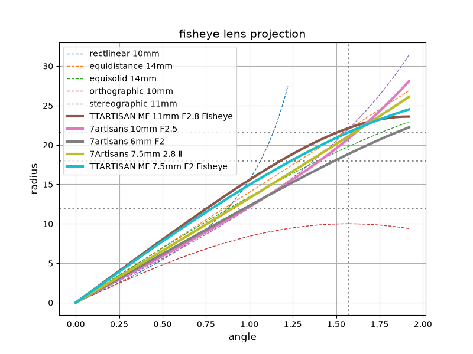

## fisheye lens projections

a script to plot a graph to compare fisheye lens projections.

it's a bit sad lens makers usually don't document their fisheye projections in the spec.
the idea here is to use vendor-provided lens profiles as a source of projection info.
a caveat is that profiles are sometimes under/over corrected though.

note: y-axis (radius) is normalized to full frame sensors. (36mm x 24mm)

